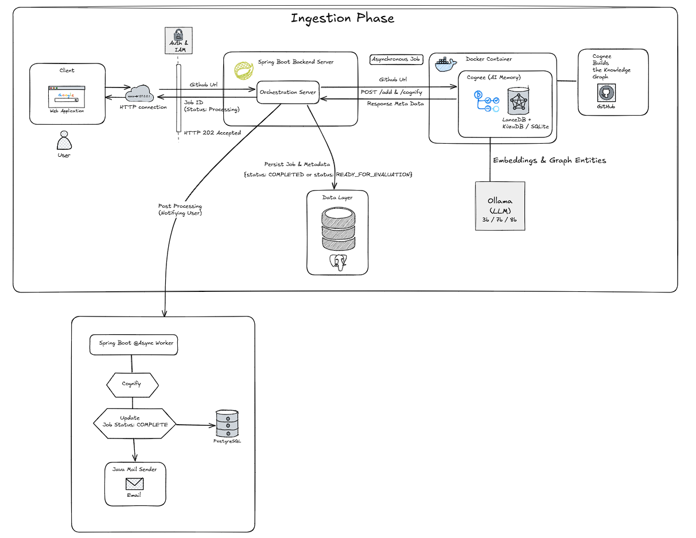
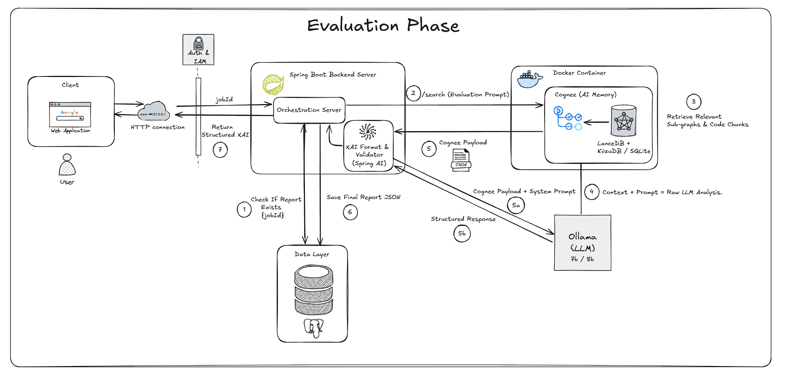

# CampusCode

CampusCode is an AI-powered code evaluation platform that ingests public GitHub repositories, builds isolated knowledge graphs using local Cognee, and generates comprehensive engineering scorecards through Spring AI with Google Gemini. The system provides evidence-based assessments across architecture, maintainability, testing, reliability, security, and performance.

## Overview

CampusCode addresses the challenge of automated code quality assessment by combining:

- **Knowledge Graph Construction**: Uses Cognee to build isolated code knowledge graphs with local FastEmbed embeddings, Kuzu graph storage, and LanceDB vector storage
- **AI-Powered Evaluation**: Leverages Spring AI with Google Gemini to generate detailed scorecards with evidence-backed insights
- **Persistent Storage**: Maintains job history, evaluation reports, and evidence bundles in local PostgreSQL
- **Semantic Search**: Enables retrieval of relevant code passages and graph neighborhoods through semantic queries

The platform follows Spring ecosystem design principles, applying portability and modular design to the AI domain while promoting strongly-typed data structures and APIs.

## Getting Started

### Prerequisites

- Java 21 or later
- Maven 3.9+
- Docker Desktop with Compose
- A Gemini API key

### Quick Start

1. **Configure environment variables**

Copy `.env.example` to `.env` and set your credentials:

```powershell
cp .env.example .env
```

Set the following in `.env`:
- `GEMINI_API_KEY`: Your Google Gemini API key
- `POSTGRES_PASSWORD` / `DATABASE_PASSWORD`: Local PostgreSQL password
- `COGNEE_USERNAME` / `COGNEE_PASSWORD`: Cognee backend credentials (align with default account values)

PostgreSQL is published on localhost port 5433 to avoid conflicts with existing installations.

2. **Start local services**

```powershell
docker compose up -d
Invoke-RestMethod `http://localhost:8000/health
docker compose ps
```

This starts Cognee (port 8000) and PostgreSQL (port 5433). Data persists in Docker volumes: `cognee_storage` for Cognee data and `campuscode_postgres` for job history.

3. **Start the Spring Boot application**

```powershell
mvn spring-boot:run
```

The API will be available at ``http://localhost:8080`.

4. **Optional: Start Cognee graph UI**

```powershell
docker compose --profile ui up -d
```

Access the UI at ``http://localhost:3000`.

For detailed setup instructions, see [RUNNING_THE_APPLICATION.md](RUNNING_THE_APPLICATION.md).

## Features

- **Repository Ingestion**: Accepts public GitHub repository URLs and processes them through Cognee for knowledge graph construction
- **Knowledge Graph Visualization**: Generates and serves HTML-based graph visualizations through Cognee
- **AI-Powered Evaluation**: Evaluates repositories across six dimensions using Spring AI and Google Gemini:
  - Architecture
  - Maintainability
  - Testing
  - Reliability
  - Security
  - Performance/Scalability
- **Evidence-Based Scoring**: Each dimension includes score rationales, strengths, areas for improvement, and source code citations
- **Semantic Search**: Query indexed repositories to retrieve relevant code passages and graph neighborhoods
- **Job Persistence**: All ingestion and evaluation jobs are tracked with status history in PostgreSQL
- **Email Notifications**: Optional email notifications upon evaluation completion (configurable SMTP)
- **Streaming Evaluation**: Real-time progress updates via Server-Sent Events (SSE)
- **Audit Trail**: Complete evidence bundles available for inspection, including exact payloads sent to Gemini

## Architecture

CampusCode follows a modular architecture:

```
┌─────────────┐
│   React     │
│   Client    │
└──────┬──────┘
       │ HTTP
┌──────▼──────┐
│ Spring Boot │
│   API       │
└──────┬──────┘
       │
┌──────▼──────┐     ┌──────────┐
│  Cognee     │────▶│ Gemini  │
│  (Local)    │     │  API     │
└──────┬──────┘     └──────────┘
       │
┌──────▼──────┐
│ PostgreSQL  │
│  (Local)    │
└─────────────┘
```

### Ingestion Phase



### Evaluation Phase



**Data Flow**:
1. React client submits repository URL to Spring Boot API
2. Spring Boot forwards to Cognee for ingestion and knowledge graph construction
3. Cognee processes repository, builds embeddings, stores in Kuzu graph and LanceDB vector store
4. Spring Boot retrieves relevant passages and graph neighborhoods from Cognee
5. Evidence bundle is sent to Gemini via Spring AI for evaluation
6. Gemini generates scorecard with citations
7. Results are persisted in PostgreSQL and returned to client

## API Documentation

The CampusCode API provides a comprehensive set of endpoints for repository ingestion, evaluation, and retrieval. Full API documentation with examples is available at:

**[CampusCode API Documentation](`https://documenter.getpostman.com/view/41403866/2sBYHYuy7j)**

### Key Endpoints

#### Repository Ingestion

```http
POST /api/repositories/ingestions
Content-Type: application/json

{
  "repositoryUrl": "`https://github.com/owner/repository",
  "notificationEmail": "optional@example.com"
}
```

The API returns `202 Accepted` and an ingestion ID. `notificationEmail` is optional. Repeated submissions for a repository reuse its latest non-failed ingestion; failed ingestions can be retried by submitting again.

#### Check Ingestion Status

```http
GET /api/repositories/ingestions/{ingestionId}
```

Wait for `COMPLETED` before evaluation. On service restart, any interrupted job is persisted as `FAILED` with a retry explanation.

#### Request Evaluation

```http
POST /api/repositories/ingestions/{ingestionId}/evaluations
```

Evaluation is asynchronous. The response contains an evaluation ID and `QUEUED` status. The scorecard rates architecture, maintainability, testing, reliability, security, and performance/scalability from 0–5 with equal weight. The overall score is the mean normalized to 0–100.

#### Streaming Evaluation (SSE)

```http
POST /api/repositories/ingestions/{ingestionId}/evaluations/stream
Accept: text/event-stream
```

It emits `progress` events during retrieval, generation, validation, and report saving, followed by `completed` with the saved report or `failed` with the evaluation error. A frontend can call this with `fetch` and read the response stream. This route reuses an active evaluation; the original JSON endpoint above is unchanged.

#### Retrieve Report

```http
GET /api/repositories/evaluations/{evaluationId}
GET /api/repositories/ingestions/{ingestionId}/report
```

Each dimension includes a score rationale, evidence-backed strengths, areas for improvement, and citations. Citation line ranges must be present in Cognee source metadata; unsupported ranges and claims are omitted. A dimension without verifiable evidence is returned as score 0 with an insufficient-evidence rationale and no citations. The exact evidence and bounded graph neighborhood provided to Gemini are available separately:

#### Evidence Inspection

```http
GET /api/repositories/ingestions/{ingestionId}/report/evidence
```

Returns the exact evidence bundle sent to Gemini, including graph neighborhoods.

#### Semantic Search

```http
POST /api/repositories/search
Content-Type: application/json

{
  "repositoryUrl": "`https://github.com/owner/repository",
  "query": "How does the application authenticate users?"
}
```

Retrieves relevant code passages without generating answers.

#### Graph Visualization

```http
GET /api/repositories/graph/visualization?repositoryUrl=<encoded-url>
Accept: text/html
```

Returns HTML visualization of the repository knowledge graph.

## Project Resources

- [Complete Setup Guide](RUNNING_THE_APPLICATION.md) - Detailed Windows local setup and run instructions
- [Frontend Implementation Plan](FRONTEND_IMPLEMENTATION_PLAN.md) - React client architecture, API mapping, and UI acceptance criteria
- [Frontend README](frontend/client/README.md) - Client setup and development commands
- [API Documentation](`https://documenter.getpostman.com/view/41403866/2sBYHYuy7j) - Complete API reference with examples

## Development

### Building from Source

```powershell
mvn clean install
```

This builds all modules, runs unit tests, and publishes artifacts to your local Maven repository.

### Running the React Client

Start the backend with `mvn spring-boot:run`, then in a separate terminal:

```powershell
Set-Location "C:\Users\Asus\Documents\ChatGPT\Cognee Setup\frontend\client"
npm install
npm run dev
```

The development server proxies `/api` requests to ``http://localhost:8080`.

### Local Email Testing with Mailpit

For development without external SMTP, use Mailpit:

1. Add to `.env`:
```dotenv
MAIL_HOST=localhost
MAIL_PORT=1025
MAIL_USERNAME=
MAIL_PASSWORD=
MAIL_FROM=campuscode@localhost
MAIL_SMTP_AUTH=false
MAIL_SMTP_STARTTLS=false
```

2. Start Mailpit:
```powershell
docker compose --profile mail up -d mailpit
```

3. Access inbox at `http://localhost:8025

4. Restart CampusCode to load new settings

## Troubleshooting

### Health Checks

- **Cognee**: `GET `http://localhost:8000/health`
- **CampusCode**: `GET `http://localhost:8080/actuator/health`
- **Database status**: `docker compose ps`

### Logs

Cognee or Gemini errors are recorded in the associated job’s `FAILED` status and error field. Search/evaluation logs include job IDs and stage durations.

## Run the React client

Start CampusCode with `mvn spring-boot:run`, then start the client in another PowerShell window:

```powershell
Set-Location "C:\Users\Asus\Documents\ChatGPT\Cognee Setup\frontend\client"
npm install
npm run dev
```

Open the Vite URL printed in the terminal. The development server proxies `/api` requests to ``http://localhost:8080`. The first iteration supports repository submission, ingestion and evaluation progress, and saved scorecards; history and semantic search remain later work. The [frontend README](frontend/client/README.md) includes the client commands, and the [desktop submission target](frontend/design/submission-target.png) records the visual reference used for the first screen.

## Future work

- Add an explicit repository refresh/re-ingestion operation so newer GitHub commits can be indexed and evaluated. Preserve prior ingestion versions and their evaluation reports rather than overwriting historical results.
- Build the repository graph visualization into the CampusCode frontend after the report retrieval/evaluation work is stable.

See [RUNNING_THE_APPLICATION.md](RUNNING_THE_APPLICATION.md) for the complete Windows local setup and run instructions.

See [FRONTEND_IMPLEMENTATION_PLAN.md](FRONTEND_IMPLEMENTATION_PLAN.md) for the Fern-inspired React client plan, current API mapping, required backend work, and UI acceptance criteria.

